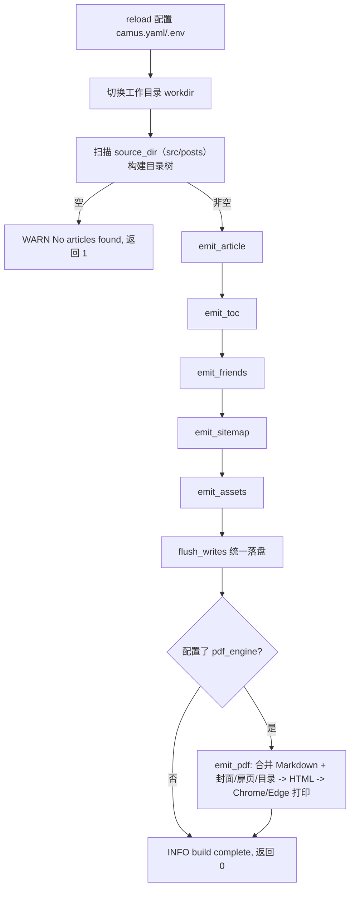

# 1. 产品概述

## 1.1 定位

Camus 是一个用 C++23 编写的静态站点生成器：读取 Markdown 文章与主题模板，生成静态 HTML 站点。核心特性：

- 单文件自包含：示例站点模板嵌入二进制，可用 `-i` 一键初始化。
- Markdown（cmark-gfm）渲染，支持 Front Matter 与隐藏片段。
- 多主题：内嵌 `default`、`document`、`pixel`、`terminal` 等主题，本地可覆盖或自定义。
- 目录树与目录索引页、统计页、友链页、`sitemap.xml`、`meta.json` 生成。
- 可选 PDF 输出：把全部可见文章合并为单个 Markdown，经 cmark-gfm 转 HTML 后调用 Chrome/Edge 无头模式打印为 PDF。
- `-W` 监听模式：轮询文件变化并自动重建，同时提供本地 HTTP 服务。
- `private` 目录：源目录下任意名为 `private` 的子目录不参与扫描与生成，也不能作为目录页路由；`-i` 安装时自动创建且不被 `.gitignore` 忽略。

当前版本：**11.1.0**（来源：`CMakeLists.txt` 的 `project(... VERSION 11.1.0)`）。

## 1.2 技术栈与依赖

| 组件 | 用途 | 来源 |
|---|---|---|
| C++23 | 实现语言 | 根 `CMakeLists.txt` 设置 `CMAKE_CXX_STANDARD 23` |
| cmark-gfm | Markdown → HTML | `third-party/cmark-gfm` |
| yaml-cpp | 读取 `camus.yaml` | `third-party/yaml-cpp` |
| inja | HTML 模板渲染 | `third-party/inja` |
| nlohmann/json | JSON 数据模型与输出 | `third-party/nlohmann_json` |
| cpp-httplib | 监听模式本地 HTTP 服务 | `third-party/cpp-httplib` |
| libarchive | 解压内嵌的模板压缩包 | 系统依赖，`pkg_check_modules(ARCHIVE ...)` |
| CPack | 生成 deb/pkg 等安装包 | `camus/CMakeLists.txt` |
| Chrome / Edge（可选） | 无头模式把中间 HTML 打印为 PDF | 系统已安装的浏览器，按 `render.pdf_engine` 解析 |

依赖全部以 Git submodule 形式存在（`.gitmodules`），构建时需 `git submodule update --init --recursive`。

## 1.3 二进制结构与自解压

构建后处理脚本 `hack/post_build.sh` 会把 `example/`（排除 `html` 与 `.camus`）打包为 tar.gz 追加到可执行文件末尾，再追加 8 字节元信息：

```
| 程序本体 | tar.gz 模板 | skip (4B) | count (4B) |
```

- `skip`：程序本体字节数（大端），即压缩包起始偏移。
- `count`：压缩包字节数（大端）。
- 运行时 `-i` 读取末尾 8 字节定位并解压（详见 §8）。

## 1.4 构建流水线

`writer::build()`（`camus/src/writer.cpp:800`）的执行顺序：



`emit_article` 内部又分为：路由解析 → Front Matter 解析 → 清空输出目录 → 收集文章 → 填充上一篇/下一篇 → 计算 TOC → 逐篇渲染与统计 → 统计页 → 目录属性收尾（详见 §4、§6）。

## 1.5 关键术语

| 术语 | 含义 |
|---|---|
| workdir | 工作目录，`-w` 指定，默认当前目录；运行时会 `chdir` 到该目录 |
| source_dir | Markdown 源目录；固定按 `src` → `posts` 探测，不存在则回退 `src` |
| dest_dir | HTML 输出目录，固定 `./dist/html` |
| pdf_dir | PDF 输出目录，固定 `./dist/pdf` |
| assets_dir | 本地静态资源目录，固定 `./assets`；缺省时使用 `.camus/assets`，内容会被提升到输出根目录 |
| catalog | 运行期内存中的目录树 `catalog_node` |
| route | `camus.yaml` 中 `catalog` 段的目录配置，可设置标题/副标题/描述/搬运 |
| transfer | 路由内的文件搬运映射，把源目录内容映射到另一输出路径 |
| short-path | 文章短链接标识，输出到 `/s/{short_path}.html` |
| hidden | 文章可见性：不渲染、不进入输出目录树 |
| private | 源目录下任意层级名为 `private` 的子目录；不扫描、不生成、不可作为目录页路由，`-i` 时自动创建 |
| 隐藏片段 | Markdown 中 `--hidden-section-start` 与 `--hidden-section-end` 之间不渲染的内容 |

## 1.6 版本信息

| 项 | 值 | 来源 |
|---|---|---|
| 版本号 | 11.1.0 | `CMakeLists.txt` |
| 主版本 | 10 | `PROJECT_VERSION_MAJOR` |
| 版本输出示例 | `v11.1.0 Release with CMake 3.28.3 and C++ 23` | `camus/main.cpp:110` |
| 构建信息 | `Build Time: <时间> hash=<git 40 位 hash>` | `config.h.in` + `camus/main.cpp:113` |
