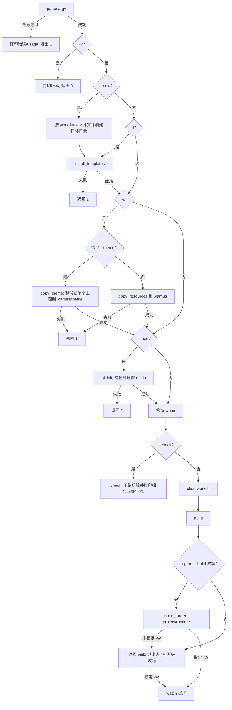

# 2. 命令行接口

入口：`camus/main.cpp:86`，使用 `common/common/cmdline/cmdline.h` 中的 `cmdline::parser` 解析。程序名显示为 `Great writer Camus`。

## 2.1 语法

```bash
camus [选项] [--workdir <目录>]
```

所有选项均为可选；带值选项为 `-w/--workdir`、`--new`；`--open` 与 `--repo` 的值可省略（裸 `--open` 等价 `--open project`，裸 `--repo` 等价只执行 `git init`）。

## 2.2 选项表

| 短选项 | 长选项 | 参数 | 说明 | 代码位置 |
|---|---|---|---|---|
| `-h` | `--help` | 无 | 打印帮助并退出（注意退出码为 1） | `main.cpp:90` |
| `-v` | `--version` | 无 | 打印版本、构建信息与 git hash 后退出 0 | `main.cpp:91` |
| `-i` | `--install` | 无 | 从平台数据目录安装 `camus.yaml`、`posts`（含各目录的 `SUMMARY.md` 与 `posts/private/`）、`.gitignore` 到工作目录（已存在的不覆盖），随后继续构建 | `main.cpp` |
| `-c` | `--copy` | 无 | 把精简资源复制到 `<workdir>/.camus`（仅创建 `assets/css`、`assets/js` 并复制 `style.css`、`onload.js`），随后继续构建 | `main.cpp` |
|  | `--theme` | 可选值：主题名 | 仅与 `--copy` 搭配：无值时复制整个 `theme/`，有值时只复制 `theme/<name>/` 到 `<workdir>/.camus/theme`；同时复制最小 assets（`style.css`、`onload.js`、`fonts/`），不补齐示例文件，也不执行 `--full` | `main.cpp` |
|  | `--full` | 无 | 与 `--copy` 搭配时复制平台数据目录的完整资源树到 `.camus` | `main.cpp` |
| `-f` | `--force` | 无 | `--copy` 时覆盖 `.camus` 中已存在的同名资源 | `main.cpp` |
| `-d` | `--debug` | 无 | 开启调试日志 | `main.cpp:11` |
| `-W` | `--watch` | 无 | 监听文件变化并自动重建，同时启动本地服务 | `main.cpp:11` |
| `-D` | `--dryrun` | 无 | 干跑：不写任何输出文件 | `main.cpp:12` |
| `-C` | `--check` | 无 | 校验配置、资源与 PDF 设置，并执行一次干跑构建后输出检查报告；不写文件 | `main.cpp` |
|  | `--new` | 目录字符串 | 创建目录（相对 `--workdir` 或绝对路径），自动执行 `--install`，并继续执行 `--repo` 与构建 | `main.cpp` |
|  | `--repo` | 可选值：远程地址 | 在 `--workdir` 执行 `git init`；提供值时设置 `origin`（已存在则更新），不提供时只 init | `main.cpp` |
|  | `--open` | 可选值：`project`（默认）/`runtime` | 构建成功后打开目录：`project` 用 VS Code 打开工作目录，`runtime` 用系统文件管理器打开数据目录；未知值打印 WARN 并按 `project` 处理 | `main.cpp` |
| `-w` | `--workdir` | 目录字符串，默认 `.` | 工作目录 | `main.cpp:14` |

> 资源来源：主题、默认资源与示例模板由安装包放到平台数据目录。`-i` 只安装工作目录根部的示例文件；`-c` 默认只生成最小可编辑资源骨架（`assets/css/style.css`、`assets/js/onload.js`），`-c --full` 才复制完整资源到 `.camus`，`-c --theme [name]` 则只复制主题。复制后资源查找会叠加 `.camus`，未复制时使用数据目录（见 §8）。

## 2.3 解析规则

- 支持组合短选项，例如 `-Cdw /tmp/site`；组合中最后一个带值选项会消费下一个参数。
- 支持长选项 `--name`，带值选项支持 `--name value` 与 `--name=value`。
- 未知长/短选项会被记录为错误；解析失败或存在 `-h` 时，输出 `error_full()` + `usage()` 并返回 **1**。
- 非选项位置参数被收集到 `rest()`，当前主程序**未使用**。
- 解析成功后，`-d` 或编译期 `WORK_ON_DEBUG=true`（Debug/RelWithDebInfo 构建）会把日志级别设为 DEBUG。
- `--open` / `--repo` / `--new` 的值处理：解析前会把裸 `--open` 归一化为 `--open=project`、裸 `--repo` 归一化为 `--repo=`；若下一参数不以 `-` 开头（如 `--open runtime`、`--repo <url>`、`--new mysite`），则作为其值消费。`--name=value` 写法直接按值解析。
- `--new` 必须提供非空目录值；`--new=` 或裸 `--new` 会打印 `option needs value: --new` 并退出 1。

## 2.4 模式与执行流程

`main` 根据选项组合执行，核心分支如下（`camus/main.cpp`）：



要点：

- `--new <dir>` 先把目标解析为「`--workdir` 下的相对路径」或绝对路径并创建，随后等同于同时传入 `--install`：补齐 `camus.yaml`、`posts`（含 `SUMMARY.md`、`posts/private/`）与 `.gitignore`。之后若指定 `--repo` 再初始化仓库，最后继续构建。
- `-i` 只补齐工作目录根部的 `posts`（含各目录的 `SUMMARY.md` 与空的 `posts/private/`）、`camus.yaml`、`.gitignore`，同名路径已存在则保持不动；`posts/private/` 每次都会确保存在。
- `-c` 默认最小复制：只创建 `<workdir>/.camus/assets/css`、`.camus/assets/js`、`.camus/assets/fonts`，并从数据目录复制 `style.css`、`onload.js` 与整个 `fonts/`；随后补齐工作目录根部缺失的示例文件。
- `-c --full` 复制完整资源（`theme/`、`assets/`、`posts/`（含各目录的 `SUMMARY.md` 与 `posts/private/`）、`camus.yaml`、`.gitignore`）到 `.camus`，并补齐工作目录根部缺失的示例文件。
- `-c --theme` 只复制 `theme/` 到 `<workdir>/.camus/theme`；`-c --theme pixel` 只复制 `theme/pixel/`；同时复制最小 assets（`style.css`、`onload.js`、`fonts/`），不补齐示例文件，且优先于 `--full`。`--theme` 未搭配 `-c` 时打印错误并返回 1。
- `-f` 仅在 `-c` 时生效：最小复制时覆盖已存在的 `style.css` / `onload.js` / `fonts/` 同名文件；完整复制时先清空 `<workdir>/.camus`（受 §6.1 文件数保护）再重新复制，工作目录已有文件不会被覆盖；`--theme` 时覆盖已存在的同名主题与 assets 文件，否则跳过。
- `--repo` 在 `--workdir` 执行 `git -C <workdir> init -q`；提供远程地址时进一步执行 `git remote get-url origin`，已存在则 `remote set-url origin`，否则 `remote add origin`。无远程地址时只初始化。失败返回 1。
- `--check` 在构建前执行：内部把 dryrun 置为 true，重新加载配置并执行一次干跑构建，然后输出工作目录、源目录、主题、资源、PDF 资源和目录树等检查信息；不写文件，结果以退出码 0（OK）/1（FAILED）表示。
- `-W` 时即使首次 `build()` 返回非 0，也会进入 `watch()` 循环继续等待变化。
- `--open` 仅在 `build()` 返回 0 时执行，且只执行一次：非 watch 模式在打开后按结果退出，watch 模式先打开再进入监听循环。
- `--open project` 依次尝试 `code <workdir>` 与 macOS 的 `open -a "Visual Studio Code" <workdir>`；`--open runtime` 在 macOS 使用 `open <数据目录>`，其它平台使用 `xdg-open <数据目录>`。打开失败打印错误并返回 1（watch 模式不退出）。

## 2.5 版本输出

签名/格式（`camus/main.cpp:109-114`）：

```text
v{PROJECT_VERSION} {BUILD_TYPE} with CMake {CMAKE_VERSION} and C++ {CXX_STANDARD}
Build Time: {BUILD_TIMESTAMP} hash={GIT_COMMIT_HASH}
```

示例（版本号以 `CMakeLists.txt` 为准）：

```text
v{PROJECT_VERSION} Release with CMake 3.28.3 and C++ 23
Build Time: 2025-07-24 15:44:00 hash=<40 位 git hash>
```

持久性：仅打印，不写文件。

## 2.6 退出码

| 场景 | 退出码 | 来源 |
|---|---|---|
| 正常构建完成 | 0 | `build()` 返回 0 |
| 版本输出 | 0 | `main.cpp:115` |
| 帮助 | 1 | `main.cpp:102` |
| 参数解析失败 | 1 | `main.cpp:102` |
| 无文章（目录树为空） | 1 | `writer.cpp:812`（非 watch 模式） |
| 安装/复制失败（数据目录无资源或复制异常） | 1 | `install_templates` / `copy_resources` 返回 1 |
| `git init` / remote 设置失败 | 1 | `init_repository` 返回 1 |
| `--check` 发现错误 | 1 | `writer::check()` 返回 1 |
| `--open` 打开失败 | 1 | `open_target` 返回 1（仅非 watch 模式退出） |
| 致命错误（配置缺失、渲染失败、输出目录文件过多等） | 127 | `logging::fatal` → `std::exit(127)` |
| 未捕获异常 | 127 | catch 中 `logging::fatal` 退出 |

## 2.7 常用示例

```bash
camus -iw mysite          # 安装示例配置/文章到 mysite 并构建
camus -cw mysite          # 复制最小资源骨架到 mysite/.camus 并构建
camus -c --full -w mysite  # 复制完整资源到 mysite/.camus 并构建
camus -cf --full -w mysite # 强制重装完整资源到 mysite/.camus 并构建
camus -c --theme -w mysite          # 只复制整个 theme 到 mysite/.camus/theme
camus -c --theme pixel -w mysite    # 只复制 theme/pixel 到 mysite/.camus/theme/pixel
camus -cf --theme pixel -w mysite   # 强制覆盖已存在的 pixel 主题文件
camus -icw mysite         # 安装示例文件并复制完整资源后构建
camus -w mysite           # 构建 mysite
camus -Ww mysite          # 监听 mysite 并自动重建
camus --check             # 校验配置、资源与 PDF 设置，并输出目录树
camus --new mysite        # 创建 mysite、安装示例文件并构建
camus --new mysite --repo git@github.com:user/site.git  # 创建并初始化仓库后构建
camus --repo              # 在当前工作目录 git init
camus --repo git@github.com:user/site.git               # git init 并设置 origin
camus -D -v               # 版本信息（-D 对 -v 无影响）
camus -dw /tmp/site       # 调试日志 + 构建
camus --open              # 构建后在 VS Code 打开工作目录
camus --open runtime      # 构建后用文件管理器打开数据目录
```
