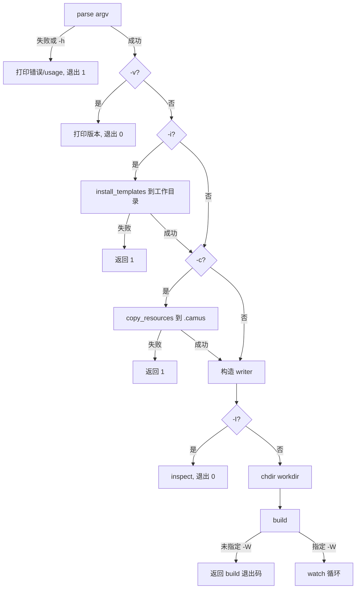

# 2. 命令行接口

入口：`camus/main.cpp:86`，使用 `common/common/cmdline/cmdline.h` 中的 `cmdline::parser` 解析。程序名显示为 `Great writer Camus`。

## 2.1 语法

```bash
camus [选项] [--workdir <目录>]
```

所有选项均为可选；唯一带值选项是 `-w/--workdir`。

## 2.2 选项表

| 短选项 | 长选项 | 参数 | 说明 | 代码位置 |
|---|---|---|---|---|
| `-h` | `--help` | 无 | 打印帮助并退出（注意退出码为 1） | `main.cpp:90` |
| `-v` | `--version` | 无 | 打印版本、构建信息与 git hash 后退出 0 | `main.cpp:91` |
| `-i` | `--install` | 无 | 从平台数据目录安装 `camus.yaml`、`catalog.yaml`、`posts`、`.gitignore` 到工作目录（已存在的不覆盖），随后继续构建 | `main.cpp` |
| `-c` | `--copy` | 无 | 把平台数据目录的完整资源复制到 `<workdir>/.camus`，随后继续构建 | `main.cpp` |
| `-f` | `--force` | 无 | `--copy` 时覆盖已有 `.camus` | `main.cpp` |
| `-d` | `--debug` | 无 | 开启调试日志 | `main.cpp:11` |
| `-W` | `--watch` | 无 | 监听文件变化并自动重建，同时启动本地服务 | `main.cpp:11` |
| `-D` | `--dryrun` | 无 | 干跑：不写任何输出文件 | `main.cpp:12` |
| `-I` | `--inspect` | 无 | 打印当前配置并执行一次干跑构建、打印目录树 | `main.cpp:13` |
| `-w` | `--workdir` | 目录字符串，默认 `.` | 工作目录 | `main.cpp:14` |

> 资源来源：主题、默认资源与示例模板由安装包放到平台数据目录。`-i` 只安装工作目录根部的示例文件，`-c` 才把完整资源复制到 `.camus`；复制后资源查找优先 `.camus`，未复制时使用数据目录（见 §8）。

## 2.3 解析规则

- 支持组合短选项，例如 `-Idw /tmp/site`；组合中最后一个带值选项会消费下一个参数。
- 支持长选项 `--name`，带值选项支持 `--name value` 与 `--name=value`。
- 未知长/短选项会被记录为错误；解析失败或存在 `-h` 时，输出 `error_full()` + `usage()` 并返回 **1**。
- 非选项位置参数被收集到 `rest()`，当前主程序**未使用**。
- 解析成功后，`-d` 或编译期 `WORK_ON_DEBUG=true`（Debug/RelWithDebInfo 构建）会把日志级别设为 DEBUG。

## 2.4 模式与执行流程

`main` 根据选项组合执行，核心分支如下（`camus/main.cpp`）：



要点：

- `-i` / `-c` 不会在安装/复制后退出：成功后继续执行构建。
- `-i` 只补齐工作目录根部的 `posts`、`camus.yaml`、`catalog.yaml`、`.gitignore`，同名路径已存在则保持不动。
- `-c` 把完整资源（`theme/`、`assets/`、`posts/`、`camus.yaml`、`catalog.yaml`、`.gitignore`）复制到 `.camus`，并补齐工作目录根部缺失的示例文件。
- `-f` 仅在 `-c` 时生效：先清空 `<workdir>/.camus`（受 §6.1 文件数保护）再重新复制，工作目录已有文件不会被覆盖。
- `-I` 在构建前执行，`inspect()` 内部把 dryrun 置为 true，因此不会写文件。
- `-W` 时即使首次 `build()` 返回非 0，也会进入 `watch()` 循环继续等待变化。

## 2.5 版本输出

签名/格式（`camus/main.cpp:109-114`）：

```text
v{PROJECT_VERSION} {BUILD_TYPE} with CMake {CMAKE_VERSION} and C++ {CXX_STANDARD}
Build Time: {BUILD_TIMESTAMP} hash={GIT_COMMIT_HASH}
```

示例（版本号以 `CMakeLists.txt` 为准）：

```text
v{PROJECT_VERSION} Release with CMake 3.28.3 and C++ 23
Build Time: 2025-07-24 15:44:00 hash=<40 位 git hash>
```

持久性：仅打印，不写文件。

## 2.6 退出码

| 场景 | 退出码 | 来源 |
|---|---|---|
| 正常构建完成 | 0 | `build()` 返回 0 |
| 版本输出 | 0 | `main.cpp:115` |
| 帮助 | 1 | `main.cpp:102` |
| 参数解析失败 | 1 | `main.cpp:102` |
| 无文章（目录树为空） | 1 | `writer.cpp:812`（非 watch 模式） |
| 安装/复制失败（数据目录无资源或复制异常） | 1 | `install_templates` / `copy_resources` 返回 1 |
| 致命错误（配置缺失、渲染失败、输出目录文件过多等） | 127 | `logging::fatal` → `std::exit(127)` |
| 未捕获异常 | 127 | catch 中 `logging::fatal` 退出 |

## 2.7 常用示例

```bash
camus -iw mysite          # 安装示例配置/文章到 mysite 并构建
camus -cw mysite          # 复制完整资源到 mysite/.camus 并构建
camus -cfw mysite         # 强制重装 mysite/.camus 并构建
camus -icw mysite         # 安装示例文件并复制完整资源后构建
camus -w mysite           # 构建 mysite
camus -Ww mysite          # 监听 mysite 并自动重建
camus -I                  # 打印配置 + 干跑构建 + 打印目录树
camus -D -v               # 版本信息（-D 对 -v 无影响）
camus -dw /tmp/site       # 调试日志 + 构建
```
