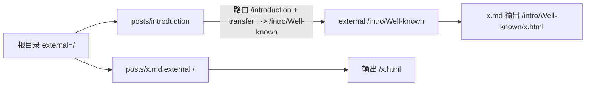
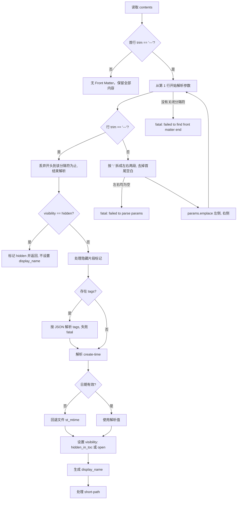

# 4. 内容目录树与文章解析

实现：`camus/src/catalog.h`、`camus/src/catalog.cpp`、`camus/src/writer.cpp`。

## 4.1 目录树构建

`build_catalog_tree(path, relative_path)`（`catalog.cpp:8`）从源目录 `source_dir` 递归扫描（源目录固定按 `src` → `posts` 探测，见 §3.2）：

- 根节点 `path` 归一为 `/`；子节点 `path` 为相对源目录的路径。
- **`private` 目录跳过**：任意层级中名为 `private` 的目录（常量 `CAMUS_PRIVATE_DIR`，定义于 `config.h.in`）不读取、不生成，也不进入目录树；用于存放不参与构建的本地私有内容。
- 普通文件：读入全部内容并按 `\n` 拆分为 `contents`（`read_file(..., true)`，整体两端空白会被裁剪）。源目录中的 `SUMMARY.md`（`CAMUS_SUMMARY_NAME`）是目录元信息文件，扫描时直接跳过，不进入目录树。
- 目录：仅当「有子节点」或「目录非空」时加入（空目录被忽略）；加入的目录节点 `directory = true`。
- 符号链接：**先于**目录/文件判断检测（`entry.is_symlink()`），任意符号链接都会触发 `logging::fatal("catalog does not support symlinks ...")`，不会跟随链接进入源目录之外或造成循环。
- 其它类型（设备、管道等）：`logging::fatal("catalog does not support file ...")`。
- `catalog_node::is_directory()` 返回节点上的 `directory` 标记（由扫描阶段设置），不再依赖「是否有子节点」。
- 非 `.md` 普通文件也会成为节点，但后续因 `display_name` 为空被判定为 `invalid()` 并从树中移除（见 §4.9）。
- 同一目录下的子节点按 `path` 字符串排序，保证多次构建结果稳定。

## 4.2 catalog_node 结构

| 字段 | 说明 |
|---|---|
| `path` | 相对源根目录的路径；根为 `/` |
| `path_prefix` | 输出路径前缀，等于 `public_url.path_prefix` |
| `directory` | 是否由源目录中的目录生成；决定 `is_directory()` |
| `contents` | 文件行内容；目录无意义 |
| `property` | 见下表 |
| `render_data_` | 渲染期数据（stats/page/nav） |
| `children` | 子节点 |

`catalog_node::empty()` 返回「无子节点且无内容」；`is_directory()` 返回 `directory`。

`catalog_property`：

| 字段 | 说明 |
|---|---|
| `write_time` | 创建/发布时间（Unix 秒）；目录取子节点最大值 |
| `visibility` | `open` / `hidden` / `hidden_in_toc` |
| `external_path` | 对外输出路径（经路由与搬运后） |
| `display_name` | 显示名，同时决定输出文件名 |
| `short_path` | 短链接标识 |
| `subtitle` / `description` | 目录副标题/描述 |
| `cover_image` | 目录/站点封面图路径（根目录的该字段供 PDF 封面使用） |
| `tags` | 文章标签 |
| `invalid()` | `display_name.empty()` |

`to_json` 输出键：`title`、`write_time`、`path`（`real_url` 去掉 `path_prefix`）、`is_dir`、`link_path`（仅有 `short_path` 时非空）、目录附 `desc`/`subtitle`、文件附 `tags`、以及 `render_data`。

## 4.3 路由与输出路径解析

`resolve_directory_routes()`（`writer.cpp:82`）先序遍历目录节点：

1. 根目录：`path_prefix = public_url.path_prefix`，`external_path = "/"`，`display_name` 取目录名（根为空，收尾时回退 `site.title`）。
2. 子目录：默认继承父目录的 `external_path` 并追加自身目录名；文件默认继承父目录的 `external_path`（因此父目录的搬运会完整作用到所有后代）。
3. 若命中 `SUMMARY.md` 生成的路由（`match_route`），用路由的 `title/subtitle/description` 覆盖元信息（非空字段才覆盖）；`cover_image` 作为路由字段保留供 PDF 封面使用。
4. 搬运匹配（`yaml_config::match_transfer`）在 `camus.yaml` 的 `transfer` 段展平后的规则中查找当前目录路径：支持 `source: .`（路由目录自身）与 `source: 子目录`（路由路径下拼接的子目录）；命中则覆盖当前目录的 `external_path`。
5. 当前目录的 `external_path` 会写给它下面的直接子节点（目录追加目录名，文件直接继承）。

> 路由 `path` 中只要包含名为 `private` 的路径段，该路由会在配置解析阶段被忽略并打印 WARN（`yaml_config.cpp`），因此 `private` 不能作为目录页路由使用。

因此文件节点的 `external_path` 来自其父目录；目录的最终输出前缀由路由/搬运决定；父目录的搬运会传递给所有后代目录与文件。同一 `path` 的多条 `transfer` 会全部参与匹配，按配置顺序取第一条命中的目标。



- 路由匹配使用清理后的路径比较（`path_equal(..., true)`）。
- 目录未命中路由/搬运时 `external_path` 由父目录输出路径 + 自身目录名得到（如 `/introduction`），最终 `real_url` 经 `clean_path` 归一。
- 根目录 `external_path` 为 `/`，顶层文章输出在输出根目录。

## 4.4 Front Matter 解析

`parse_article_frontmatter()`（`writer.cpp:109`）对每个 `.md` 节点执行：



细节：

- Front Matter **可选**：仅当首行 trim 后为 `---` 时才进入解析；否则全部内容原样保留（首行不会被丢弃）。
- 关闭分隔符是后续任意一行 trim 后为 `---`（含紧邻首行的空 Front Matter `---\n---`）；解析阶段会丢弃「首行到关闭分隔符（含）」的整段，因此正文中真正的 Markdown 水平线不会被误删。
- 若首行是 `---` 但直到文件末尾都没有关闭分隔符，致命退出。
- 参数行按第一个 `:` 拆分为键值（`split_pair(..., 2)`），左右均 trim；空键空值会致命退出。
- 重复键保留**第一次**出现的值（`map::emplace`）。
- 标签必须是合法 JSON 数组字符串，例如 `[ "a", "b" ]`；解析失败致命退出。
- 日期格式：无空格时按 `%Y-%m-%d`，有空格时按 `%Y-%m-%d %H:%M:%S`，按 **UTC**（`timegm`）解析；无效日期回退文件修改时间，`stat` 失败则 `write_time = 0`。

## 4.5 Front Matter 字段

| 字段 | 类型 | 默认 | 说明 |
|---|---|---|---|
| `title` | 字符串 | 文件名词干 | 页面标题与输出文件名；会先做 inja 变量渲染，再把 `/`、`\`、`'`、`"` 替换为空格 |
| `short-path` | 字符串 | 空 | 为空则不启用短链；`auto` 用节点路径 hash 生成；否则原样使用 |
| `create-time` | 字符串 | 文件 mtime | 发布/修改时间 |
| `visibility` | 字符串 | `open` | `hidden`：不渲染、从树中移除；`hidden_in_toc`：见 §4.6 |
| `tags` | JSON 数组字符串 | 空 | 文章标签，参与统计页 |

`short-path: auto` 的生成规则（`writer.cpp:211-214`）：对节点相对路径做 FNV-1a 64 位 hash，再取 `hash % (UINT16_MAX * 2)`（即 `% 131070`），格式化为小写十六进制。短链固定输出到 `/s/<short_path>.html`。

`filename_case: uuid` 时，`display_name` 直接生成 UUID v4（与文件名无关），因此普通输出路径也是 `/s/...` 之外的 UUID 文件名；`short-path` 仍可另行启用。

## 4.6 可见性语义（以代码为准）

| 值 | 渲染 | 进入目录树/TOC | 进入 sitemap | 说明 |
|---|---|---|---|---|
| `open`（默认） | 是 | 是 | 是 | 正常文章 |
| `hidden` | 否 | 否 | 否 | 解析时立即返回，`display_name` 为空，收尾时因 `invalid()` 被移除 |
| `hidden_in_toc` | 是 | **否**（从 TOC/目录项/友链页列表中过滤） | 是 | 仍渲染文章页、参与上一篇/下一篇与统计；只是不出现在导航列表 |

> 注意：SUMMARY 中的 `hidden-in-toc` 写法（连字符）不会被识别；代码识别的是 `hidden_in_toc`（下划线）。`build_toc_items()`、`emit_toc()`、`emit_friends()` 都会过滤 `hidden_in_toc`。

## 4.7 隐藏片段

在 Front Matter 之后的内容中，以下标记之间的内容会被删除（`writer.cpp:143-162`）：

```markdown
--hidden-section-start
这段内容不会出现在输出中。
--hidden-section-end
```

- 标记必须**整行完全匹配**（不 trim），带空格不会命中。
- 标记本身也会被删除；未闭合时从开始标记删到文件末尾。
- 处理在 Markdown 渲染之前完成。

## 4.8 URL 计算

`catalog_node` 提供两个 URL（`catalog.h:125-145`）：

```text
real_url():
  目录          -> clean_path(external_path)
  文件 invalid  -> ""
  文件          -> clean_path(external_path + "/" + display_name + ".html")

link_url():
  short_path 非空 -> clean_path("/s/" + short_path + ".html")
  否则            -> real_url()
```

`clean_path(path, prefix)` 等价于 `lexically_normal(prefix + "/" + path)`，特殊处理 Linux 下 `//` → `/`。

序列化到模板 JSON 时（`to_json`），`path` 与 `link_path` 都使用带 `public_url.path_prefix` 的完整链接（主题直接作为 `href` 使用）。例外：`emit_toc()` 会额外把 `current.path` 覆盖为相对目录树的原始路径（如 `/`、`/introduction`），供主题判断是否根目录。

文章渲染会**同时写入** `link_url()` 与 `real_url()`（`writer.cpp`），两者相同时只写一次（`std::set` 去重）。

## 4.9 排序、过滤与导航

- `collect_articles()`：收集所有 `.md` 且 `visibility != hidden` 的节点（含 `hidden_in_toc`），按 `write_time` **降序**（新→旧），时间相同时按 `path` 升序保证稳定。
- `finalize_directory_properties()` 在 TOC 与统计生成**之前**执行：
  - **后序**递归计算目录 `write_time`，取所有子节点（含深层后代）`write_time` 的最大值；
  - 目录空的 `subtitle/description/display_name` 分别回退到 `site` 的对应字段；
  - 移除 `invalid()` 的文件节点（`display_name` 为空，即隐藏文章与非 `.md` 文件）；
  - 移除因此变空的目录节点（`directory = true` 且 `children` 为空）。
- TOC 排序：目录优先，然后按 `write_time` 降序，时间相同按 `path` 升序。
- 上一篇/下一篇（`fill_article_nav`）：在降序文章列表中，`prev` 指向更新的一篇（索引 - 1），`next` 指向更旧的一篇（索引 + 1）；路径会加上 `public_url.path_prefix`。

## 4.10 字数与阅读时长

`render_single_article` 在 Markdown 渲染前对 Markdown 文本计算（`str.cpp:294-371`）：

- 有效长度 `effective_length = CJK 字符数 + (英文字母数 + 数字数) / 5`，向上取整；其它字符（标点、空格、emoji 等）不计入。
- 阅读时长 `read_mins = (uint16_t)(effective_length / 300.0)`，向下截断；有效长度小于 300 时为 0。
- 常量来源：`READING_SPEED = 300.0`（`str.cpp:294`）。
- 统计累加到 `stats["all"]`，以及满足 `1996 < year < 2200` 的年份桶；年份公式为 `1970 + write_time / (365 * 86400)`（**近似年**，非日历精确值）。
- 目录节点自身的 `render_stats` 不含字数/时长（文件才有）。

## 4.11 目录遍历

`traverse_catalog_tree(node, fn, depth)` 为**先序**深度优先：先对当前节点调用 `fn`，再依次递归子节点，`depth` 从 0 开始。路由、Front Matter、渲染、sitemap、check 复用它；`finalize_directory_properties()` 为计算目录统计单独使用后序递归。
