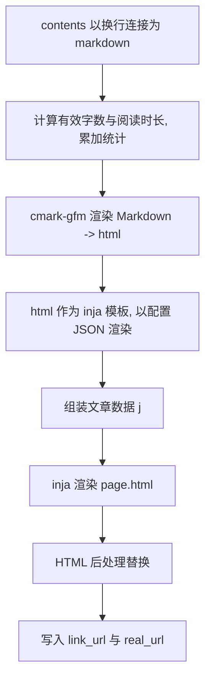

# 5. 模板与渲染

实现：`common/common/render/render.cpp`、`camus/src/writer.cpp`、`camus/src/yaml_config.cpp`。

## 5.1 主题解析

主题由四个模板组成，类型枚举 `camus_theme_type`（`yaml_config.h:51`）：

| 类型 | 文件 | 用途 |
|---|---|---|
| `CAMUS_THEME_TYPE_HOME` | `home.html` | 目录索引页 |
| `CAMUS_THEME_TYPE_PAGE` | `page.html` | 文章页 |
| `CAMUS_THEME_TYPE_STATS` | `stats.html` | 统计页 |
| `CAMUS_THEME_TYPE_FRIENDS` | `friends.html` | 友链页 |

加载顺序（`yaml_config.cpp:244-264`）：

1. 若本地存在 `theme/{theme_name}/{type}.html`，优先使用本地覆盖。
2. 否则查找 `.camus/theme/{theme_name}/{type}.html`（`-i` 安装）。
3. 仍未找到时在平台数据目录中查找同名文件（macOS `~/Library/Application Support/Camus`，Linux `/var/lib/camus`）。
4. 文件不存在时 `logging::fatal("read theme content failed ...")`，进程退出 127。

`theme_name` 默认 `default`；示例站点使用 `terminal`。HTML 引擎固定为 `default`（inja），不再从配置读取，`theme_name` 也不会再拼接引擎子路径。

## 5.2 Markdown 渲染

`render_markdown(html, engine, opt)`（`render.cpp`）：

- 仅支持 `engine == "cmark-gfm"`；其它引擎 `logging::fatal("unsupported engine type ...")`。
- 调用 `cmark_markdown_to_html`，失败返回空串。
- 选项位由 `render.markdown_options` 映射（见 §3.4），Debug/RelWithDebInfo 构建默认带 `CMARK_OPT_SOURCEPOS`。

## 5.3 文章渲染流程

`render_single_article()`（`writer.cpp:317`）：

- **Markdown 内联模板**：Markdown 渲染后的 HTML 会再用配置 JSON 做一次 inja 渲染，因此正文中可使用 `{{ build.version }}` 等配置变量（注意与 Markdown 语法/花括号冲突时的转义需求）。
- `display_name` 也会先经 inja 渲染，再清洗 `/`、`\`、`'`、`"` 为空格（§4.5）。

## 5.4 inja 自定义函数

在 `writer` 构造时注册（`writer.cpp:661-689`），可在任意主题模板/正文中使用：

| 函数 | 签名 | 行为 | 示例 |
|---|---|---|---|
| `format_datetime` | `format_datetime(unix_ts)` → string | UTC `%Y-%m-%d %H:%M:%S` | `{{ format_datetime(page.write_time) }}` |
| `format_date` | `format_date(unix_ts)` → string | UTC `%Y-%m-%d` | `{{ format_date(page.write_time) }}` |
| `with_prefix` | `with_prefix(path)` → string | `clean_path(path, public_url.path_prefix)` | `{{ with_prefix("index.html") }}` |
| `with_cdn` | `with_cdn(path)` → string | 拼接 `public_url.protocol + public_url.domain_name + with_prefix(path)` 的完整 URL | `{{ with_cdn("css/a.css") }}` |

`with_cdn` 仅依赖 `public_url` 配置拼接 URL，不再读取任何环境变量。

## 5.5 文章页渲染数据

`render_single_article` 组装的 JSON `j`（`writer.cpp:359-369`）由配置数据叠加节点数据得到：

| 键 | 结构 | 说明 |
|---|---|---|
| `camus` / `source_dir` / `assets_dir` / `meta` / `sitemap` / `filename_case` / `public_url` / `protocol` / `domain_name` / `path_prefix` / `render` / `friends` / `site` / `route` / `git` / `build` | 见 §3.7 | 站点配置 |
| `title` | 字符串 | 文章显示名（来自节点 `to_json`） |
| `write_time` | 数字 | 文章时间戳 |
| `path` | 字符串 | 节点 `real_url` 加上 `public_url.path_prefix` 的完整链接（主题直接作 `href`） |
| `is_dir` | bool | 文章为 false |
| `link_path` | 字符串 | 短链路径，无短链时为空 |
| `tags` | 数组 | 文章标签 |
| `toc` | 数组 | 顶级目录/文章项（见 §5.6） |
| `page.title` | 字符串 | 同 `display_name` |
| `page.write_time` | 数字 | 同上 |
| `page.description` | 字符串 | 固定为空串 |
| `page.contents` | 字符串 | 已渲染的正文 HTML |
| `stats.word_count` | 数字 | 有效字数 |
| `stats.read_min` | 数字 | 阅读分钟数 |
| `nav.next_path` / `nav.next_title` | 字符串 | 下一篇（更旧） |
| `nav.prev_path` / `nav.prev_title` | 字符串 | 上一篇（更新） |
| `render_data.stats/page/nav` | 对象 | 节点自带的渲染数据（与顶层 `stats/page/nav` 同源） |

`page.html` 渲染后还会做 HTML 后处理（见 §5.8）。

## 5.6 TOC 数据项

`build_toc_items()` 取根节点直接子节点中 `visibility` 既不是 `hidden` 也不是 `hidden_in_toc` 的项，序列化为 `catalog_node` JSON，并排序（目录优先，再按 `write_time` 降序，时间相同按 `path` 升序）。该数组用于文章页/统计页的导航。

`emit_toc` / `emit_friends` 中会对每个目录页构造：

| 键 | 结构 | 说明 |
|---|---|---|
| `parent.url` | 字符串 | 父目录 `link_url` 加上 `public_url.path_prefix` 的完整链接；根目录为空 |
| `parent.label` | 字符串 | 父目录显示名；父目录为根时固定为 `/` |
| `items` | 数组 | 当前目录直接子节点（过滤 `hidden` 与 `hidden_in_toc`；目录优先，再按时间降序、`path` 升序） |
| `current` | 对象 | 当前目录节点 JSON（含 `render_data`）；其中 `current.path` 被覆盖为相对目录树路径（根为 `/`） |
| 其余键 | — | `conf_.json()` 的顶层键（`camus/source_dir/assets_dir/meta/sitemap/filename_case/public_url/protocol/domain_name/path_prefix/render/friends/site/route/git/build`）被合并进来 |

`meta.json` 的 `catalog` 数组按目录树的先序顺序输出，保证结果稳定。

注意：这些目录页数据是「父级 + 子项 + 当前目录」结构，不是完整递归树。

## 5.7 统计页与友链页数据

- 统计页：`{ ...conf, toc, stats }`，其中 `stats` 为对象：
  - `all`：全站聚合；
  - 数字键（如 `"2025"`）：按年份聚合。
  - 每项字段：`articles`、`words`、`read_mins`、`min_time`、`max_time`、`tags`（数组）。
- 友链页：`{ ...conf, toc, friends }`，`friends` 为 §3.6 的数组。

## 5.8 HTML 后处理

文章页最终 HTML 会执行一组替换（`strings::replace(..., map, deep=true)`）：

| 查找 | 替换 |
|---|---|
| ` 00:00:00` | 空串 |
| ``）会被保留。

## 5.9 渲染错误处理

- 模板 inja 渲染异常：打印出错行号附近内容（`strings::mark_string`）后 `logging::fatal`，退出 127。
- Markdown 引擎缺失/不支持：`logging::fatal` 退出 127。
- 主题文件缺失：`logging::fatal` 退出 127。
- 文章 `link_url` 为空：`logging::fatal("make article failed ...")`。

持久性：渲染结果仅写入输出目录，可随时重建；无运行期缓存（除数据目录中的主题文件与内存队列）。

## 5.10 PDF 模板与样式

PDF 的 HTML 模板与打印样式不再硬编码在 `writer.cpp`，而是作为独立资源放在 `theme/pdf/`（常量 `CAMUS_PDF_THEME_DIR`，`config.h.in`）：

| 文件 | 常量 | 作用 |
|---|---|---|
| `theme/pdf/page.html` | `CAMUS_PDF_TEMPLATE_NAME` | 完整 PDF 中间 HTML 文档模板（inja） |
| `theme/pdf/style.css` | `CAMUS_PDF_STYLE_NAME` | 打印样式，由模板通过 `{{ pdf.style }}` 内联到 `<style>` |

加载顺序（`writer::emit_pdf()` → `read_pdf_theme_file()`，`writer.cpp`）：

1. 工作目录 `theme/pdf/<file>`（显式本地覆盖）。
2. `paths::find_resource("theme/pdf/<file>")`：先 `.camus/theme/pdf/<file>`（`-i` 安装），再平台数据目录。
3. 均不存在时 `logging::fatal("read pdf theme content failed name=...")`，退出 127。

`page.html` 使用 inja 渲染，上下文为 §3.7 的配置 JSON 加上 `pdf` 对象：

| 键 | 类型 | 说明 |
|---|---|---|
| `pdf.lang` | 字符串 | 站点标题非空时为 `zh-CN`，否则为 `en` |
| `pdf.title` | 字符串 | 已 HTML 转义的封面标题（站点标题为空时回退 `Camus`） |
| `pdf.style` | 字符串 | `style.css` 经配置 JSON 渲染后的内容（可写 inja 配置变量） |
| `pdf.intro` | 字符串 | 引导页 Markdown（`# site.title` + `site.description`）渲染后的 HTML，**未转义** |
| `pdf.cover` | 对象 | `eyebrow`、`title`、`subtitle`、`description`、`meta`（生成日期），均按模板需要预转义 |
| `pdf.title_page` | 对象 | `title`、`subtitle` |
| `pdf.meta` | 对象 | `article_count`、`generated_at`、`domain`、`version` |
| `pdf.toc` | 数组 | 每项 `anchor`、`index`、`number`（两位序号）、`title`、`tags`；`title`/`tags` 已转义 |
| `pdf.articles` | 数组 | 每项 `anchor`、`index`、`number`、`title`、`tags`、`content`；`content` 为渲染后的文章 HTML，**未转义** |

- `style.css` 先以配置 JSON 单独渲染（可使用 `{{ build.version }}`、`{{ site.title }}` 等配置变量），再作为 `pdf.style` 字符串插入 `page.html`；`page.html` 自身以「配置 JSON + `pdf` 对象」渲染。插入的样式内容不会被二次解析。
- 默认模板生成的 HTML 结构、封面/扉页/目录/文章分页样式与原硬编码版本一致；用户可整体替换 `page.html`，或只覆盖 `style.css`。
- 输出 `dist/pdf/index.html` 是模板渲染结果；`dist/pdf/index.md` 仍由程序生成，不受模板影响。
- 页面写入成功与否只影响 PDF 阶段；模板缺失属于配置错误，会以致命错误退出（与普通主题缺失一致）。
- 模板/样式源文件持久于工作目录 `theme/pdf`、`.camus` 或数据目录；生成的 `dist/pdf` 产物可随时重建。
