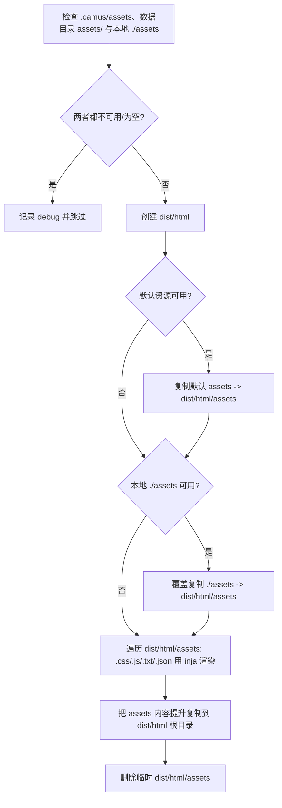

# 6. 输出产物

实现：`writer::build()` 各阶段（`camus/src/writer.cpp`）。输出目录固定：HTML 写入 `./dist/html`，PDF 写入 `./dist/pdf`（不可配置）。

## 6.1 输出目录清理与安全保护

`prepare_output_dir()`（`writer.cpp:220`）在渲染文章前执行：

```text
empty_path(dest_dir(),  safe_check=true)   // ./dist/html
empty_path(pdf_dir(),   safe_check=true)   // ./dist/pdf
```

`empty_path(path, true)`（`filesystem.cpp:136`）规则：

- 路径不存在：直接返回（不创建）。
- 若存在，递归扫描文件数（最多 10000 个）：
  - 文件数 **> 200**：`logging::fatal("Too many files and need to be deleted manually ...")`，退出 127，**不会删除**；
  - 否则 `remove_all` 清空。
- 因此输出目录文件数超过 200 时必须人工清理后才能构建。

构建结束后各写入路径会由 `flush_writes()` 通过 `create_directories(parent_path)` 自动创建。

## 6.2 输出文件布局

以示例站点（启用 sitemap/meta 与 PDF）为例：

```text
dist/
├── html/                           # HTML 站点
│   ├── <文章 real_url>             # 如 dist/html/introduction/M/Mozart!.html
│   ├── s/<short_path>.html         # 启用 short-path 时的短链副本
│   ├── <目录 real_url>/index.html  # 每个目录节点一页（含根目录 dist/html/index.html）
│   ├── stats.html
│   ├── friends.html
│   ├── sitemap.xml                 # sitemap=true
│   ├── meta.json                   # meta=true
│   └── <assets 内容提升到根>        # css/ js/ fonts/ robots.txt favicon.ico ...
└── pdf/                            # pdf_engine 非空且不为 disable 时
    ├── index.md                    # 合并后的 Markdown
    ├── index.html                  # PDF 中间 HTML
    ├── index.pdf                   # 最终 PDF（可由 pdf_options 自定义路径）
    ├── cover.<ext>                 # cover_image 有效时复制为封面（保留原扩展名）
    └── fonts/                      # theme/pdf/fonts/ 存在时复制
        └── <字体文件>
```

| 产物 | 触发条件 | 代码位置 |
|---|---|---|
| 文章页 | 每篇 `visibility != hidden` 的 `.md` | `writer.cpp:392-394` |
| 目录索引页 | 每个非空目录节点（含根；空目录在收尾阶段被移除） | `writer.cpp` `emit_toc()` |
| `stats.html` | 始终（除非 dryrun） | `writer.cpp:408` |
| `friends.html` | 始终（除非 dryrun） | `writer.cpp:461` |
| `sitemap.xml` | `sitemap: true` | `writer.cpp:555` |
| `meta.json` | `meta: true` | `writer.cpp:540-545` |
| 静态资源 | 数据目录 `assets/` 或本地 `./assets` 非空 | `writer.cpp` `emit_assets()` |
| `index.md` / `index.pdf` / `index.html`（均位于 `dist/pdf`） | `pdf_engine` 非空、不为 `disable` 且引擎可用 | `writer.cpp` `emit_pdf()` |
| `dist/pdf/fonts/` | `theme/pdf/fonts/` 存在 | `writer.cpp` `copy_pdf_theme_fonts()` |

## 6.3 文章输出

- 写入路径为 `out_dir / clean_path(url, "./")`，`out_dir = relative(dest_dir, workdir)`。
- 同时写入 `link_url()` 与 `real_url()`；二者相同时去重。
- `short-path` 启用时，`/s/<short>.html` 与普通文章路径内容相同。
- 同一路径重复入队会 `logging::fatal("output file already queued ...")`。

## 6.4 目录索引页（TOC 页）

`emit_toc()`（`writer.cpp:467`）：

- HTML 引擎固定为 `default`（inja 模板），不再从配置读取。
- 遍历所有目录节点，为每个目录构造 §5.6 的目录页数据，用 `home.html` 渲染。
- 输出路径：`dest_dir/{real_url}/index.html`（根目录为 `dest_dir/index.html`）。
- 注意 `current` 为目录节点，`items` 为其直接子节点；深层目录通过各自的页面表达，不展开为完整递归树。

## 6.5 统计页 `stats.html`

`render_stats_page()`（`writer.cpp:397`）使用 `stats.html` 模板，数据为 `{ ...conf, toc, stats }`（见 §5.7）。

`stats` 对象字段（`article_stats`）：

| 字段 | 类型 | 说明 |
|---|---|---|
| `articles` | 数字 | 文章数 |
| `words` | 数字 | 有效字数合计 |
| `read_mins` | 数字 | 阅读分钟数合计 |
| `min_time` | 数字 | 最早文章时间 |
| `max_time` | 数字 | 最晚文章时间 |
| `tags` | 字符串数组 | 去重后的标签集合 |

`all` 桶的 `min_time` 初始为 `time_t` 最大值；年份桶以 `1996 < 1970 + write_time/(365*86400) < 2200` 过滤，键为年份字符串。

## 6.6 友链页 `friends.html`

`emit_friends()` 使用 `friends.html` 模板，数据为 `{ ...conf, toc, friends }`；`toc` 为根节点直接子节点（过滤 `hidden` 与 `hidden_in_toc`）排序后的数组。输出到 `dest_dir/friends.html`。

## 6.7 `sitemap.xml`

`emit_sitemap()`（`writer.cpp:553`）在 `sitemap` 为 true 时生成：

```xml
<?xml version="1.0" encoding="UTF-8"?>
<urlset xmlns="http://www.sitemaps.org/schemas/sitemap/0.9">
  <url><loc>{full_prefix}{node.link_url}</loc><lastmod>{YYYY-MM-DD}</lastmod></url>
</urlset>
```

- `full_prefix = protocol + domain_name + path_prefix`（来自 public_url）。
- 只包含非目录节点；条目间以换行 + 制表符分隔。
- 使用 `link_url`：启用 `short-path` 时 `<loc>` 为短链地址。
- 包含 `open` 与 `hidden_in_toc` 的文章，不包含 `hidden`。
- 输出为 `dest_dir/sitemap.xml`。

## 6.8 `meta.json`

`emit_toc()` 内当 `meta` 为 true 时生成（`writer.cpp:540-545`），内容为：

```json
{
  "config": { "...": "conf_.json()" },
  "catalog": [
    {
      "parent": { "url": "...", "label": "..." },
      "items": [ { "title": "...", "path": "...", "is_dir": true, "...": "..." } ],
      "current": { "...": "目录节点 JSON" }
    }
  ]
}
```

- `config` 为完整站点配置 JSON（§3.8）。
- `catalog` 每项对应一个目录节点，按目录遍历顺序（先序）追加。
- 每条记录仅含 `parent`、`items`、`current`（`config` 的合并发生在入数组之后，不会污染数组项）。
- 以 4 空格缩进输出。

## 6.9 静态资源

`emit_assets()`（`writer.cpp`）：



- 资源按三层叠加：平台数据目录 `assets/`（macOS `~/Library/Application Support/Camus`，Linux `/var/lib/camus`）→ `.camus/assets`（`-c` 最小或完整复制）→ 本地 `./assets`；后层覆盖前层同名文件。
- 本地资源目录固定为 `./assets`；存在且非空时整体覆盖前两层同名文件，不存在或为空时使用前两层。
- 默认最小复制只包含 `css/style.css` 与 `js/onload.js`，其余主题资源仍从平台数据目录加载。
- 默认资源包含空文件 `css/style.css` 与 `js/onload.js`，所有内置主题都会引用它们；本地未覆盖时输出同名空文件，不报错。
- 仅 `.css`、`.js`、`.txt`、`.json` 会做 inja 变量替换，其它文件原样复制。
- 最终资源被**提升到输出根目录**（如 `dist/html/css/...`、`dist/html/robots.txt`），不保留 `assets/` 前缀。

## 6.10 dryrun 的影响

`-D/--dryrun` 下：

| 阶段 | 行为 |
|---|---|
| `prepare_output_dir` | 不清理输出目录 |
| `add_write` | 直接返回，不排队 |
| `flush_writes` | 队列为空，无写入 |
| `emit_toc` | 提前返回（不生成目录页/meta） |
| `emit_assets` | 提前返回 |
| `emit_pdf` | 提前返回 |
| 文章/统计/友链/sitemap | 正常计算并调用 `add_write`，但不落盘 |

因此 dryrun 可用于验证配置与渲染流程而不改变磁盘。

## 6.11 PDF 输出

`emit_pdf()` 在 `flush_writes()` 之后执行，仅在顶层 `pdf_engine` 非空且不为 `disable` 时生效：

```mermaid
flowchart TD
    A[pdf_engine 为空或为 disable] -->|是| Z[跳过]
    A -->|否| B[解析 Chrome/Edge 可执行文件]
    B -->|未找到| W[WARN 并跳过]
    B -->|找到| C[按目录树先序收集 visibility != hidden 的 .md]
    C --> D[合并为单个 Markdown]
    D --> E[写 dist/pdf/index.md]
    E --> F[逐篇 cmark-gfm 渲染为 HTML, 组装 pdf.toc / pdf.articles / 封面等数据]
    F --> CV[解析根 SUMMARY.md 的 cover_image, 复制为 dist/pdf/cover.<ext>]
    CV --> G[读取 theme/pdf/page.html / style.css / fonts.css, 用 inja 渲染完整文档]
    G --> H[复制 theme/pdf/fonts -> dist/pdf/fonts, 写 dist/pdf/index.html（内联样式与字体样式）]
    H --> I[调用浏览器 --headless --print-to-pdf=<解析后的输出路径>]
    I --> J{退出码为 0 且 PDF 非空?}
    J -->|否| W2[WARN 并跳过]
    J -->|是| N[解析 PDF 命名目标得到每篇起始物理页码]
    N --> O{解析到页码?}
    O -->|是| P[回填 pdf.toc[].page/page_label, 重新渲染 index.html 并再次打印 PDF]
    O -->|否| K
    P --> K[注入 PDF 书签大纲 /Outlines]
    K --> DONE[完成]
```

- 合并文档以 `# {site.title}` 开头，每篇文章为 `## {display_name}` + 正文，文章间用 `---` 分隔。
- PDF 中间 HTML 由 `theme/pdf/page.html`（inja）渲染，打印样式来自 `theme/pdf/style.css`，字体样式来自 `theme/pdf/fonts.css`；自定义字体放在 `theme/pdf/fonts/`，构建时复制到 `dist/pdf/fonts/`。这些资源均可被工作目录 `theme/pdf/`、`.camus/theme/pdf/` 或平台数据目录覆盖（详见 §5.10）。
- 默认模板在正文前依次输出三个独立页面，各自通过 `page-break-after: always` 强制分页：

  | 页面 | 模板数据 | 说明 |
  |---|---|---|
  | 封面页 | `pdf.cover` | 使用根目录 `SUMMARY.md` Front Matter 的 `cover_image`：相对路径以 `camus.yaml` 所在目录为起点，绝对路径直接使用；有效时复制为 `dist/pdf/cover.<ext>` 并整页铺满（`@page cover` 四边 0 边距、`object-fit: cover`）；未配置或文件不存在时回退站点标题（为空时 `Camus`）与 `site.subtitle` |
  | 扉页 | `pdf.title_page`、`pdf.meta` | 站点标题、副标题、站点描述（`site.description`）、生成日期（`Generated`）、站点域名（`Site`，`public_url.domain_name`）、程序版本（`Version`）；不输出文章数；标题等字号已缩小以避免与封面重复 |
  | 目录页 | `pdf.toc` | 标题 `Contents` + 按真实目录树多级缩进的分组标题（目录名）与文章显示名；不显示序号与标签；文章条目显示正文起始页码（与页脚一致）并链接到 `#pdf-article-{n}` |

- 页码从正文开始：封面使用独立命名页 `page: cover`（四边 0 边距），扉页、目录使用 `page: front`，均不输出页脚页码；`#pdf-intro` 引导页为正文第 1 页。`theme/pdf/style.css` 使用 `html { counter-reset: page {{ pdf_page_offset }}; }` 整体偏移页计数，并由 `@page { @bottom-center { content: counter(page, camus-page); color: #000; } }` 在正文页底部居中输出**黑色**页码；`@counter-style camus-page` 使用 `pad: 3 "0"`，不足 3 位前补 0（如 `001`）。`--no-pdf-header-footer` 关闭浏览器自带页眉页脚，不影响该自定义页码。
- 目录页码与页脚页码同源（均为正文页序）：第一遍 PDF 生成后由 `pdf::read_anchor_pages()` 解析 PDF 命名目标（`/Dests` 与页树 `/Kids`），以 `pdf-intro` 的物理页计算 `pdf_page_offset = 1 - intro_page`，再回填 `pdf.toc[].page = physical_page + pdf_page_offset` 与 `pdf.toc[].page_label`（`{:03}` 三位补零字符串），随后重新渲染样式与 HTML 并再次打印。默认模板在 `<body>` 顶部放置一个隐藏的 `#pdf-intro` 链接以生成该命名目标；解析失败时保留第一遍产物，目录仍可点击跳转。目录页码列使用固定宽度占位，两次排版不会互相影响。
- 最终 PDF 由 `pdf::write_outline()` 注入可交互书签大纲：解析经典 xref 表，修改 Catalog（`/Outlines`、`/PageMode /UseOutlines`），追加分级 `/Outlines` 对象（目录分组 + 文章条目，文章使用 `/Dest /pdf-article-{n}` 命名目标），并重建 xref 与 `startxref`。书签层级与 `pdf.toc[].depth` 一致，默认展开；不支持的结构（如 xref stream）下不改动文件并打印 WARN。
- 默认模板为每篇文章输出 `<section id="pdf-article-{n}" class="pdf-article">`，并以 `page-break-before: always` 从新页开始；引导页 `pdf.intro`（`# site.title` + `site.description`）单独占一页。
- 程序写入模板的站点字段（标题、副标题、描述、域名、目录标题/标签）均做 HTML 转义（`html_escape`）；文章正文与引导页为已渲染 HTML，原样插入。
- 文章正文使用 Front Matter 解析后的内容；`hidden` 文章不参与，`hidden_in_toc` 参与。
- PDF 输出路径默认 `dist/pdf/index.pdf`；`--print-to-pdf` 中可用 `{{dest_dir}}` 占位符自定义（占位符代表 `dist/pdf`），如 `--print-to-pdf={{dest_dir}}/docs/book.pdf`（相对路径按 `dist/pdf` 解析）。
- PDF 中间产物 `index.md`、`index.html` 与最终 `index.pdf` 均位于 `dist/pdf`，与 HTML 站点目录分离；存在自定义字体时 `theme/pdf/fonts/` 会复制为 `dist/pdf/fonts/`。
- 浏览器的 stderr（含 macOS `CVDisplayLinkCreateWithCGDisplay failed` 等噪声日志）不直接输出到终端，而是重定向到临时日志 `camus-pdf-<pid>.log`（位于系统临时目录）；构建成功且两遍打印均正常时删除该文件，命令失败或未产出 PDF 时保留，并在告警中给出 `log=<绝对路径>` 便于排查。
- PDF 生成成功后以 **info** 级别输出 `pdf generated dest=<绝对路径>`，提示产物位置（浏览器自身日志仍按上述规则隐藏）。
- 浏览器缺失、命令失败或未产出 PDF 只告警，不影响 HTML 站点构建结果与退出码；`theme/pdf` 模板/样式缺失属配置错误，会以致命错误退出（退出码 127）。
- `dryrun` 下整个阶段跳过。
