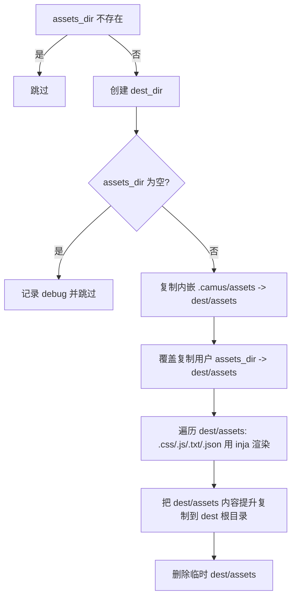

# 6. 输出产物

实现：`writer::build()` 各阶段（`camus/src/writer.cpp`）。默认 `destination` 为 `camus.yaml` 的 `output.dest_dir`（示例为 `html`）。

## 6.1 输出目录清理与安全保护

`prepare_output_dir()`（`writer.cpp:220`）在渲染文章前执行：

```text
empty_path(output.dest_dir, safe_check=true)
empty_path(dest_dir(),       safe_check=true)   // 两者为同一路径
```

`empty_path(path, true)`（`filesystem.cpp:136`）规则：

- 路径不存在：直接返回（不创建）。
- 若存在，递归扫描文件数（最多 10000 个）：
  - 文件数 **> 200**：`logging::fatal("Too many files and need to be deleted manually ...")`，退出 127，**不会删除**；
  - 否则 `remove_all` 清空。
- 因此输出目录文件数超过 200 时必须人工清理后才能构建。

构建结束后各写入路径会由 `flush_writes()` 通过 `create_directories(parent_path)` 自动创建。

## 6.2 输出文件布局

以示例站点（`dest_dir: html`、启用 sitemap/meta）为例：

```text
html/
├── <文章 real_url>                 # 如 html/introduction/M/Mozart!.html
├── s/<short_path>.html             # 启用 short-path 时的短链副本
├── <目录 real_url>/index.html      # 每个目录节点一页（含根目录 html/index.html）
├── stats.html
├── friends.html
├── sitemap.xml                     # output.sitemap=true
├── meta.json                       # output.meta=true
└── <assets 内容提升到根>            # css/ js/ fonts/ robots.txt favicon.ico ...
```

| 产物 | 触发条件 | 代码位置 |
|---|---|---|
| 文章页 | 每篇 `visibility != hidden` 的 `.md` | `writer.cpp:392-394` |
| 目录索引页 | 每个有子节点的目录节点（含根） | `writer.cpp:531-537` |
| `stats.html` | 始终（除非 dryrun） | `writer.cpp:408` |
| `friends.html` | 始终（除非 dryrun） | `writer.cpp:461` |
| `sitemap.xml` | `output.sitemap: true` | `writer.cpp:555` |
| `meta.json` | `output.meta: true` 且 `html_engine=default` | `writer.cpp:540-545` |
| 静态资源 | `assets_dir` 存在且非空 | `writer.cpp:585` |

## 6.3 文章输出

- 写入路径为 `out_dir / clean_path(url, "./")`，`out_dir = relative(dest_dir, workdir)`。
- 同时写入 `link_url()` 与 `real_url()`；二者相同时去重。
- `short-path` 启用时，`/s/<short>.html` 与普通文章路径内容相同。
- 同一路径重复入队会 `logging::fatal("output file already queued ...")`。

## 6.4 目录索引页（TOC 页）

`emit_toc()`（`writer.cpp:467`）：

- 仅在 `render.html_engine == "default"` 时工作；其它引擎 `logging::fatal("html engine '...' not supported")`。
- 遍历所有目录节点，为每个目录构造 §5.6 的目录页数据，用 `home.html` 渲染。
- 输出路径：`dest_dir/{real_url}/index.html`（根目录为 `dest_dir/index.html`）。
- 注意 `current` 为目录节点，`items` 为其直接子节点；深层目录通过各自的页面表达，不展开为完整递归树。

## 6.5 统计页 `stats.html`

`render_stats_page()`（`writer.cpp:397`）使用 `stats.html` 模板，数据为 `{ ...conf, toc, stats }`（见 §5.7）。

`stats` 对象字段（`article_stats`）：

| 字段 | 类型 | 说明 |
|---|---|---|
| `articles` | 数字 | 文章数 |
| `words` | 数字 | 有效字数合计 |
| `read_mins` | 数字 | 阅读分钟数合计 |
| `min_time` | 数字 | 最早文章时间 |
| `max_time` | 数字 | 最晚文章时间 |
| `tags` | 字符串数组 | 去重后的标签集合 |

`all` 桶的 `min_time` 初始为 `time_t` 最大值；年份桶以 `1996 < 1970 + write_time/(365*86400) < 2200` 过滤，键为年份字符串。

## 6.6 友链页 `friends.html`

`emit_friends()`（`writer.cpp:439`）使用 `friends.html` 模板，数据为 `{ ...conf, toc, friends }`；`toc` 为根节点直接子节点（过滤 `hidden`）排序后的数组。输出到 `dest_dir/friends.html`。

## 6.7 `sitemap.xml`

`emit_sitemap()`（`writer.cpp:553`）在 `output.sitemap` 为 true 时生成：

```xml
<?xml version="1.0" encoding="UTF-8"?>
<urlset xmlns="http://www.sitemaps.org/schemas/sitemap/0.9">
  <url><loc>{full_prefix}{node.link_url}</loc><lastmod>{YYYY-MM-DD}</lastmod></url>
</urlset>
```

- `full_prefix = protocol + domain_name + path_prefix`。
- 只包含非目录节点；条目间以换行 + 制表符分隔。
- 使用 `link_url`：启用 `short-path` 时 `<loc>` 为短链地址。
- 输出为 `dest_dir/sitemap.xml`。

## 6.8 `meta.json`

`emit_toc()` 内当 `output.meta` 为 true 时、且 `html_engine=default` 时生成（`writer.cpp:540-545`），内容为：

```json
{
  "config": { "...": "conf_.json()" },
  "catalog": [
    {
      "parent": { "url": "...", "label": "..." },
      "items": [ { "title": "...", "path": "...", "is_dir": true, "...": "..." } ],
      "current": { "...": "目录节点 JSON" }
    }
  ]
}
```

- `config` 为完整站点配置 JSON（§3.8）。
- `catalog` 每项对应一个目录节点，按目录遍历顺序（先序）追加。
- 每条记录仅含 `parent`、`items`、`current`（`config` 的合并发生在入数组之后，不会污染数组项）。
- 以 4 空格缩进输出。

## 6.9 静态资源

`emit_assets()`（`writer.cpp:585`）：



- 内嵌默认资源来自 `.camus/assets`（`-i` 安装时生成），用户 `assets_dir` 覆盖同名文件。
- 仅 `.css`、`.js`、`.txt`、`.json` 会做 inja 变量替换，其它文件原样复制。
- 最终资源被**提升到输出根目录**（如 `html/css/...`、`html/robots.txt`），不保留 `assets/` 前缀。
- 用户 `assets_dir` 为空目录时直接跳过（不复制内嵌资源）。

## 6.10 dryrun 的影响

`-D/--dryrun` 下：

| 阶段 | 行为 |
|---|---|
| `prepare_output_dir` | 不清理输出目录 |
| `add_write` | 直接返回，不排队 |
| `flush_writes` | 队列为空，无写入 |
| `emit_toc` | 提前返回（不生成目录页/meta） |
| `emit_assets` | 提前返回 |
| 文章/统计/友链/sitemap | 正常计算并调用 `add_write`，但不落盘 |

因此 dryrun 可用于验证配置与渲染流程而不改变磁盘。
