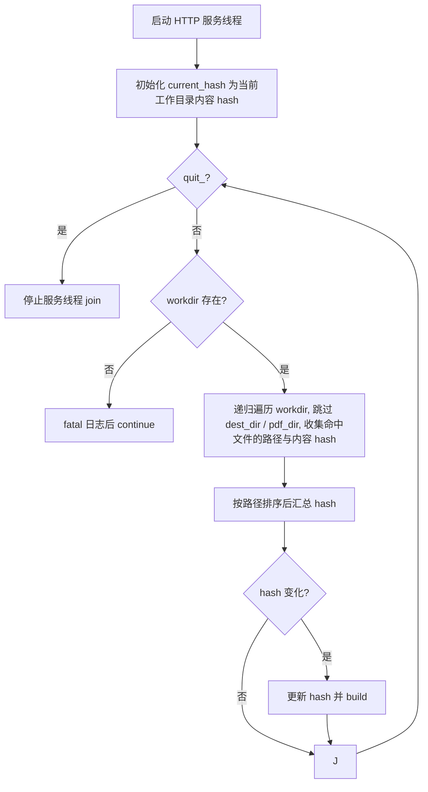

# 7. 监听模式与本地服务

实现：`writer::watch()`（`camus/src/writer.cpp:1158`）。由 `-W/--watch` 触发；启动前会先执行一次 `build()`。

## 7.1 本地 HTTP 服务

| 项 | 值 | 来源 |
|---|---|---|
| 端口 | `3001`（固定常量） | `writer.cpp:1160` `constexpr uint16_t server_port = 3001` |
| 监听地址 | `0.0.0.0`（所有网卡） | `watch_server_.listen("0.0.0.0", server_port)` |
| 文档根 | `./dist/html`（固定） | `watch_server_.set_mount_point("/", conf_.camus().dest_dir())` |
| 框架 | cpp-httplib | `common/common/net` |

`net::get_local_addr(dns_server="114.114.114.114")` 通过向 DNS 地址建立 UDP `connect`（不发送数据）并 `getsockname` 获取本机 IPv4 地址；失败返回空串，`watch()` 中 `assert(!server_addr.empty())`。服务实际绑定 `0.0.0.0`，`get_local_addr()` 得到的地址仅用于拼接日志中可直接访问的 URL（原样返回取得的 IPv4，不做 fake-ip 网段改写）。

服务在线程中运行，主线程负责轮询。

监听模式下 `public_url` 与 `cdn_url` 会在配置解析后被清空，因此构建产物使用根相对路径（`with_cdn(path)` 等价 `with_prefix(path)`，前缀为空时原样返回 `path`），避免指向公网或 CDN 的绝对地址在本地失效。

## 7.2 轮询与重建



- 轮询间隔：`500ms`（`writer.cpp:1244`）。
- 参与 hash 的文件（递归遍历整个 `workdir`）：
  - 扩展名为 `.md`、`.yaml`、`.json`；
  - **或**路径字符串中包含 `/theme/` 的任意文件。
- 遍历前对 `workdir`、`dest_dir`（`./dist/html`）与 `pdf_dir`（`./dist/pdf`）统一做 `weakly_canonical` 规范化；遍历时同时跳过这两个输出目录（目录本身不进入、子目录不再递归）。因此 `meta.json`、`index.md`、`index.html` 等构建产物都不会参与 hash，符号链接工作目录（如 macOS `/tmp` → `/private/tmp`）也不会因前缀不匹配而漏排除。
- hash 汇总方式：收集每个命中文件的「规范化绝对路径 + 内容 hash」，按路径排序后拼接，再整体做 hash；避免文件系统目录遍历顺序变化造成 hash 抖动而反复编译。
- 首次 hash 在进入循环前用当前内容初始化；只有汇总 hash 变化才触发 `build()`。
- 文件内容读取失败时返回错误字符串参与 hash（`filesystem::read_file` 行为）。

## 7.3 日志

启动时输出：

```text
watch directory: <dest_dir>
watch server listen on http://localhost:3001 or http://<addr>:3001
```

工作目录不存在时循环内 `logging::fatal("watch directory not exists ...")`（进程退出 127）。

## 7.4 生命周期与限制

- `quit_` 为 `std::atomic<bool>`，当前代码中**没有任何地方将其置为 true**，也没有注册信号处理；因此监听模式只能由外部终止进程（如 Ctrl+C）结束，`watch_server_.stop()` 分支实际上不可达。
- 端口固定 3001，不支持配置；被占用时 `listen` 失败，服务线程退出，但主循环仍继续轮询。
- 输出目录 `./dist/html` 与 PDF 目录 `./dist/pdf` 已在哈希计算中排除（含 `meta.json`、PDF 的 `index.md` 等产物），构建不会触发持续重建。
- 每次 `build()` 会重新 `reload()` 配置；注意配置重载的列表累积问题（§3.9）。
- `-W` 下首次构建失败不会阻止进入监听循环。
