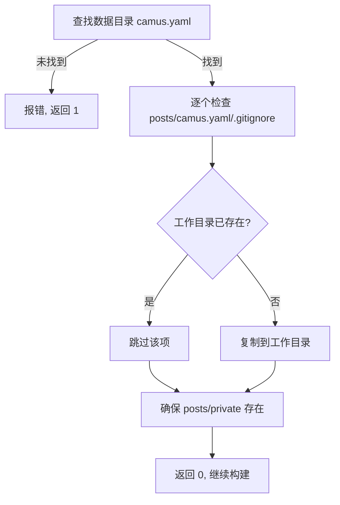
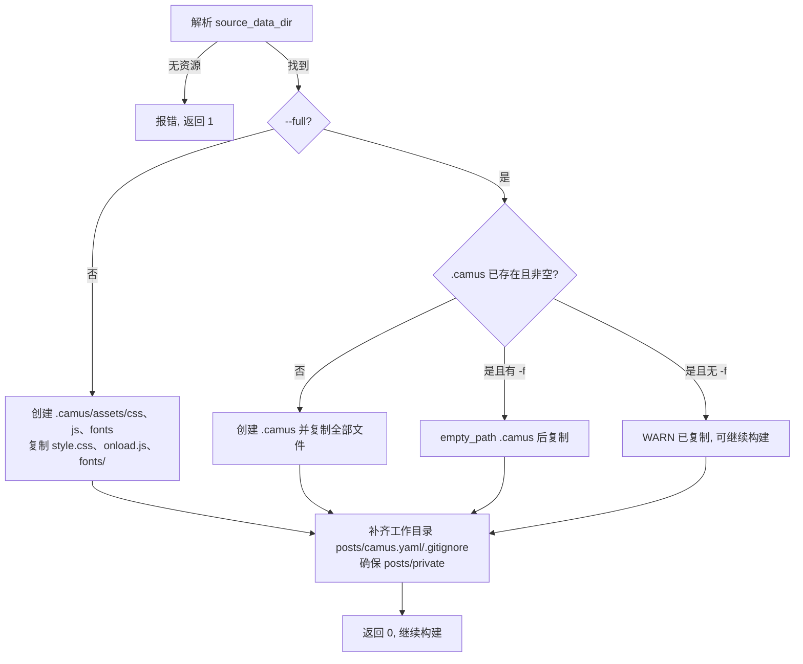
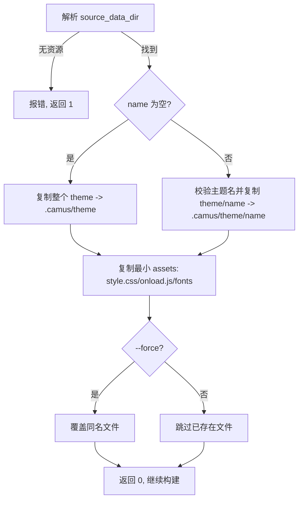

# 8. 资源安装与数据目录

实现：`camus/src/install.h`、`camus/src/install.cpp`、`common/common/paths/paths.h`、`common/common/paths/paths.cpp`、`camus/src/yaml_config.cpp`、`camus/src/writer.cpp`、`camus/CMakeLists.txt`。

> 旧版的「单文件自包含」已移除：可执行文件不再追加示例压缩包。`-i/--install` 只把示例配置与文章安装到工作目录根部；`-c/--copy` 默认复制最小资源骨架，`-c --full` 才复制完整资源到 `.camus`，`-c --theme [name]` 只复制整个或单个主题。

## 8.1 数据目录

运行期资源根目录由 `camus::paths` 解析（`paths.cpp`）：

| 平台 | 默认数据目录 | 回退 |
|---|---|---|
| macOS | `~/Library/Application Support/Camus`（`$HOME` 存在时） | `/Library/Application Support/Camus` |
| Linux | `/var/lib/camus` | 无 |

- 常量来源：`config.h.in` 的 `CAMUS_DATA_DIR_MACOS`（`Library/Application Support/Camus`）与 `CAMUS_DATA_DIR_LINUX`（`/var/lib/camus`）。
- `data_dirs()` 返回按优先级排列的候选目录；`find(relative)` 返回第一个存在的候选路径。
- `source_data_dir()` 返回第一个同时包含 `theme/` 与 `assets/` 的数据目录，供 `-c` 使用。
- `paths::find(CAMUS_CONF_NAME)` 定位包含 `camus.yaml` 的数据目录，供 `-i` 使用。
- 数据目录只读即可：构建过程不会向其写入。

目录内容（由安装包写入）：

```text
<数据目录>/
├── theme/{default,document,pixel,terminal}/{home,page,stats,friends}.html
├── theme/pdf/{page.html,style.css,fonts.css}   # PDF 模板、打印样式与字体样式
├── assets/                    # 默认静态资源（css/js/fonts/imgs/robots.txt 等）
│   ├── css/style.css          # 公共样式入口，默认空文件
│   ├── js/onload.js           # 公共脚本入口，默认空文件
│   └── fonts/                 # 站点与 PDF 共用的字体文件
├── posts/                     # 示例文章
│   ├── SUMMARY.md              # 示例站点与目录元信息（可配置 PDF cover_image）
│   └── private/                # 不参与构建的私有内容目录（安装时自动创建，含 README.md）
├── camus.yaml                 # 示例配置
└── .gitignore                 # 示例忽略规则
```

## 8.2 安装与复制

### 8.2.1 `-i/--install`（示例文件）

`install_templates()` 从 `paths::find("camus.yaml")` 所在的数据目录，把以下内容复制到工作目录根部（已存在的同名路径跳过）：

- `posts/`（含各目录的 `SUMMARY.md`）
- `posts/private/`（不存在时也会自动创建，并写入说明用途的 `README.md`）
- `camus.yaml`
- `.gitignore`



- 不会创建或修改 `.camus`。
- 无论 `posts/` 是否已存在，都会确保 `<工作目录>/posts/private/` 存在，并在缺失时写入 `README.md`（`CAMUS_PRIVATE_DIR`）。
- 工作目录不存在时自动创建（`create_directories`），因此 `-iw /tmp/site` 可直接用于全新目录。
- 成功后不退出，主程序继续构建（见 §2.4）。

### 8.2.2 `-c/--copy`（最小资源 / `--full` 完整资源）

`copy_resources()` 根据 `--full` 选择复制范围：

- 默认（最小）：只创建 `<workdir>/.camus/assets/css`、`.camus/assets/js` 与 `.camus/assets/fonts`，并从数据目录复制 `css/style.css`、`js/onload.js` 及整个 `fonts/` 目录；目标文件已存在且未指定 `-f` 时跳过。
- `--full`：把 `source_data_dir()` 的全部内容复制到 `<workdir>/.camus`。



- 最小复制可重复执行：`-f` 覆盖已有的 `style.css` / `onload.js` 与 `fonts/` 中同名文件，未指定时保留现有文件。
- `--full` 下 `.camus` 已存在且非空、未指定 `-f`：打印 WARN，仅补齐工作目录根部示例文件，不覆盖 `.camus`。
- `--full -f`：先删除 `.camus`（受 §6.1 的 >200 文件保护），再复制。
- 复制完成后，对 `posts`、`camus.yaml`、`.gitignore`：仅当工作目录根部不存在同名路径时才补齐；`posts/private/` 始终确保存在。
- 工作目录不存在时由 `<workdir>/.camus` 的 `create_directories` 一并创建。
- 复制结果持久于磁盘；`-c` 成功后不会退出，主程序继续构建（见 §2.4）。

### 8.2.3 `-c --theme [name]`（只复制主题）

`copy_theme()` 复制 `source_data_dir()/theme` 这个范围，并同时复制最小资源骨架：

- `-c --theme`：复制整个 `theme/`（含 `theme/pdf/`）。
- `-c --theme pixel`：只复制 `theme/pixel/` 到 `.camus/theme/pixel`。
- 同时复制最小资源：`assets/css/style.css`、`assets/js/onload.js` 与整个 `assets/fonts/`；不复制其他 assets，不补齐工作目录根部的 `posts` / `camus.yaml` / `.gitignore`，也不受 `--full` 影响。
- 不加 `-f` 时跳过目标中已存在的文件（可重复执行补齐缺失主题）；加 `-f` 时覆盖同名文件。
- `--theme` 未搭配 `-c` 时打印错误并返回 1；主题名非法（绝对路径或含 `.` / `..`）时返回 1。



## 8.3 资源查找顺序

复制完整资源后优先使用工作目录 `.camus`；未复制时使用平台数据目录。

主题（`yaml_config.cpp` 的 `read_theme()`）：

1. 工作目录 `theme/{theme_name}/{type}.html`（显式本地覆盖）。
2. `paths::find_resource("theme/{theme_name}/{type}.html")`：先 `.camus/theme/...`，再数据目录。
3. 均不存在时 `logging::fatal("read theme content failed name=...")`，退出 127。

PDF 模板、样式与字体（`writer.cpp` 的 `read_pdf_theme_file()` / `copy_pdf_asset_fonts()`）：

1. 工作目录 `theme/pdf/{page.html,style.css,fonts.css}`（显式本地覆盖，可只覆盖单个文件）。
2. `paths::find_resource("theme/pdf/<file>")`：先 `.camus/theme/pdf/...`，再数据目录。
3. `page.html` / `style.css` 均不存在时 `logging::fatal("read pdf theme content failed name=...")`，退出 127；`fonts.css` 可选。
4. 字体不放在 `theme/pdf/`：使用站点 `assets/fonts/`，构建后由 `copy_pdf_asset_fonts()` 复制到 `dist/pdf/assets/fonts/`，`fonts.css` 以 `assets/fonts/<file>` 引用。

静态资源（`writer::emit_assets()`）：

1. 平台数据目录 `assets/`（`paths::resource_assets_dir()`）作为基础资源。
2. `.camus/assets`：存在且非空时覆盖基础资源（`-c/--copy` 的最小或完整复制）。
3. 本地 `./assets`：存在且非空时整体覆盖前两层。
4. 三者都不可用时记录 debug 并跳过。
5. 资源最终提升到输出根目录（详见 §6.9）。

## 8.4 安装位置（CPack）

`camus/CMakeLists.txt` 安装 `example/` 下的 `theme/`、`assets/`、`posts/`（含各目录的 `SUMMARY.md`）、`camus.yaml` 与 `.gitignore`：

| 平台 / 生成器 | 资源安装目标 |
|---|---|
| Linux（DEB） | `var/lib/camus`（最终 `/var/lib/camus`） |
| macOS（productbuild，当前用户域） | `Library/Application Support/Camus` → `~/Library/Application Support/Camus` |
| macOS（productbuild，系统域，如 `installer -target /`） | `Library/Application Support/Camus` → `/Library/Application Support/Camus` |

- 安装 `example/theme` 的整个目录，因此包含 `theme/pdf/{page.html,style.css,fonts.css}` 与 `example/assets`（含 `fonts/`）。
- 可执行文件仍安装到 `/usr/local/bin/camus`。
- macOS 通过 `CPACK_PRODUCTBUILD_DOMAINS` 同时启用用户域与系统域；用户域安装到 `~/Library/...`，系统域安装到 `/Library/...`，运行期按 §8.1 的顺序查找。

## 8.5 持久性

- `-i` 安装的根部示例文件与 `posts/private/` 持久于工作目录；`-c` 复制结果持久于工作目录 `.camus`；`-c --full` 可复制完整资源，`-f` 可覆盖已有资源。
- 数据目录中的资源由安装包持久化；升级安装包会覆盖同名文件。
- 工作目录的 `theme/` 与 `./assets` 始终拥有最高优先级。
