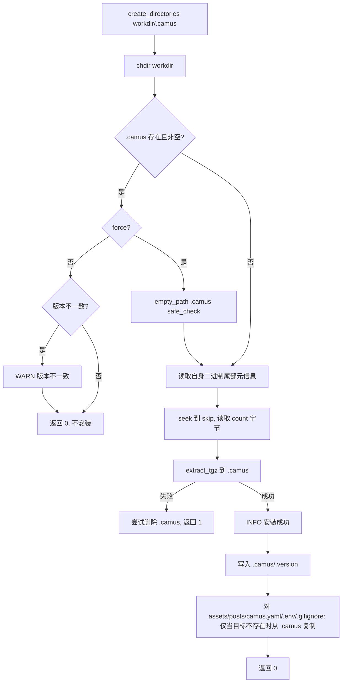

# 8. 模板安装与自解压

实现：`install_template()`（`camus/main.cpp:13`）、`extract::extract_tgz()`（`common/common/extract/extract.h`）、`hack/post_build.sh`。

## 8.1 内嵌模板格式

构建后处理脚本把示例站点追加到可执行文件末尾：

```text
| 程序本体 (skip 字节) | gzip 压缩的 tar 包 (count 字节) | skip:4B | count:4B |
```

- 打包源：`example/`，排除 `html` 与 `.camus`。
- 尾部 8 字节为两个**大端** `uint32`：`skip`（程序本体长度，即压缩包偏移）、`count`（压缩包长度）。
- 脚本在 macOS 上使用 `COPYFILE_DISABLE=1` 与 `--no-xattrs` 避免扩展属性。
- 脚本最后打印手动解包命令：`dd if=camus bs=1 skip=<skip> count=<count> | tar xzf -`。

## 8.2 安装流程

`main` 中 `-i/--install` 时调用 `install_template(self_path, WORK_ON_DEBUG || force, workdir)`：



关键行为：

- `.camus` 已存在且非空时：
  - 无 `force`：读取 `.camus/.version`，若首行版本与当前 `PROJECT_VERSION`（10.0.0）不同则告警；随后**直接返回 0**，不做任何安装。
  - 有 `force`（或 Debug/RelWithDebInfo 构建）：整目录清空后重新解压；清空同样受「>200 文件需人工删除」保护（见 §6.1）。
- `.camus` 不存在或为空：直接解压。
- 解压失败：尝试删除 `.camus`（`std::filesystem::remove` 仅能删除空目录），返回 1。
- `-i` 成功后**不会退出**，主程序继续构建（见 §2.4）。

## 8.3 安装产物

| 路径 | 来源 | 覆盖规则 |
|---|---|---|
| `.camus/` | 内嵌 tar.gz 全量解压 | force 时先清空；否则存在即跳过安装 |
| `.camus/.version` | 安装后写入 | 固定写入 `版本号\nUTC 时间` |
| `./assets/` | `.camus/assets` | **仅当目标不存在**时复制 |
| `./posts/` | `.camus/posts` | 仅当目标不存在时复制 |
| `./camus.yaml` | `.camus/camus.yaml` | 仅当目标不存在时复制 |
| `./.env` | `.camus/.env` | 仅当目标不存在时复制 |
| `./.gitignore` | `.camus/.gitignore` | 仅当目标不存在时复制 |

注意：`force` 只影响 `.camus` 目录的重装；工作目录下的 `assets/posts/camus.yaml/.env/.gitignore` 即使 force 也**不会覆盖**已有文件。

## 8.4 `.version` 文件

格式（`main.cpp:70-73`）：

```text
10.0.0
2026-11-05 05:00:00
```

- 第一行为 `PROJECT_VERSION`。
- 第二行为当前时间，使用 `functions::format_time_t(time(nullptr))`，即 **UTC** 的 `%Y-%m-%d %H:%M:%S`。
- 用于下次无 force 安装时的版本一致性检查。

## 8.5 自解压读取细节

`main.cpp:48-66`：

1. `ifstream` 以二进制打开自身可执行文件。
2. `seekg(-8, end)` 读取 `skip`、`count`，均做 `ntohl`。
3. `seekg(skip, beg)`，读取 `count` 字节到缓冲区。
4. `extract::extract_tgz` 使用 libarchive 按条目写入目标目录，保留时间戳（`ARCHIVE_EXTRACT_TIME`）。

持久性：安装结果持久于磁盘；重复执行 `-i` 在无 force 时会跳过。

## 8.6 模板嵌入脚本

`camus/CMakeLists.txt` 在 `Camus` 目标 `POST_BUILD` 阶段以 `hack/post_build.sh "${CMAKE_SOURCE_DIR}"` 执行，工作目录为 `${CMAKE_BINARY_DIR}/bin`：

```bash
CAMUS_SIZE=$(get_file_size camus)
COPYFILE_DISABLE=1 tar -c -b 1 -f - --no-xattrs -C "$DATA_DIR/example" \
  --exclude=html --exclude=.camus . | gzip -c >> camus
TEMPLATE_SIZE=$(( $(get_file_size camus) - CAMUS_SIZE ))
printf '%08x' "$CAMUS_SIZE" | xxd -r -p >> camus
printf '%08x' "$TEMPLATE_SIZE" | xxd -r -p >> camus
```

- 使用 `%08x`（大端 4 字节）写入两个长度，与运行期 `ntohl` 对应。
- 依赖 `xxd`（CI 中显式安装）。
- 该步骤使每次构建的可执行文件自带模板；修改 `example/` 后无需额外资源文件。
